# Música Hub

Sitio web de música donde la comunidad descubre canciones, vota con estrellas y consulta rankings, géneros, noticias y giras. En esta etapa (Unidad 4) la maqueta estática se migró a *PHP, se modularizó con **Server Side Includes (SSI)* y se agregaron títulos dinámicos y variables de entorno (.env).

## Prototipo en Figma
https://twice-satin-42519228.figma.site/

## Tecnologías utilizadas
- HTML5, CSS3 y Bootstrap 5
- JavaScript
- PHP 8.x
- XAMPP (Apache) como servidor local
- Git y GitHub

## Estructura del proyecto
- includes/header.php: etiquetas <head>, metadatos, hojas de estilo y título dinámico.
- includes/nav.php: menú de navegación con la clase active en la sección actual.
- includes/footer.php: pie de página y scripts de JavaScript.
- config/config.php: lee el archivo .env y define las constantes del sitio.
- .env.example: plantilla de las variables de entorno.

## Instalación y ejecución local
1. Instalar XAMPP e iniciar *Apache* desde el panel de control.
2. Clonar el repositorio dentro de C:\xampp\htdocs:
   git clone https://github.com/Fer-123778/musica-hub-php.git
3. Copiar .env.example y renombrar la copia como .env.
4. Abrir en el navegador: http://localhost/musica-hub-php/

## Evidencia de funcionamiento

### Servidor local ejecutándose

### Estructura modular (SSI)

### Navegación dinámica (título y menú activo)
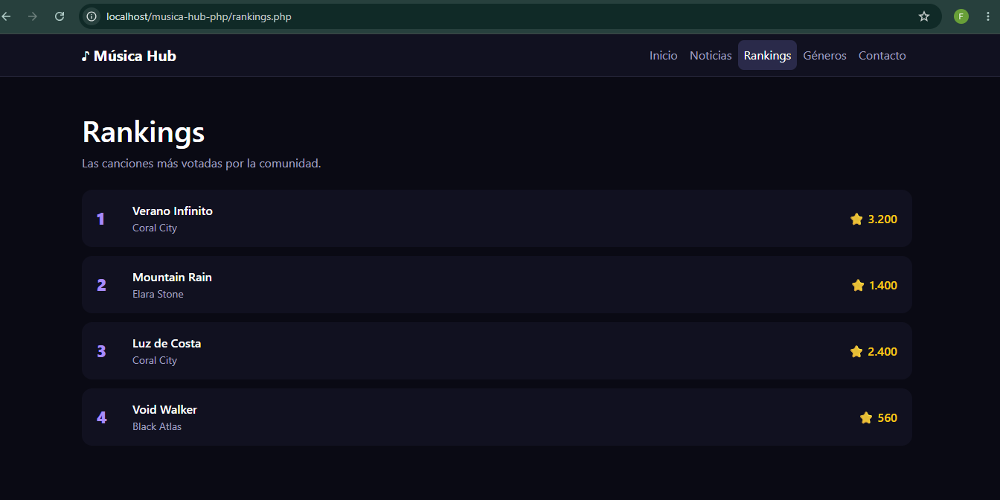

### Variables de entorno
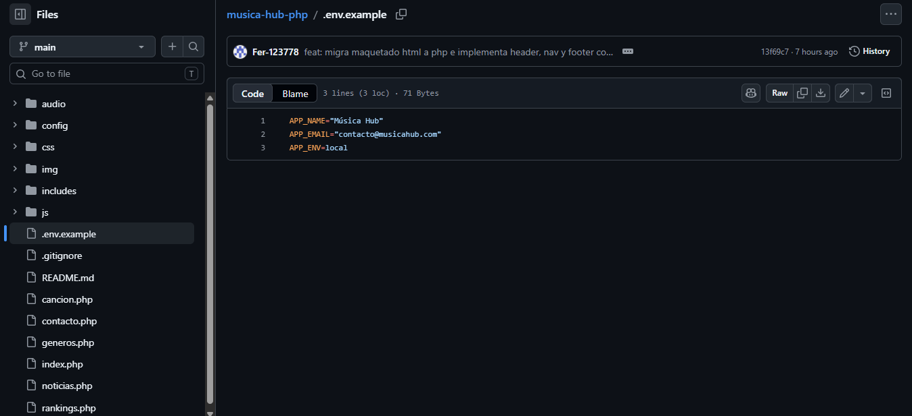

## Clase 5: Procesamiento de formularios y seguridad web

Todo el desarrollo de esta entrega está en la carpeta clase5/.

### Formulario POST: opiniones (clase5/opiniones.php)
Formulario con nombre, email y opinión. El servidor valida que ningún campo llegue vacío, que el nombre tenga al menos 2 caracteres, que el email tenga un formato válido (filter_var) y que la opinión tenga al menos 10 caracteres. Si hay errores, muestra mensajes y conserva los datos escritos. Si todo es correcto, muestra un mensaje de éxito.

### Formulario GET: buscador (clase5/buscar.php)
Buscador de canciones y artistas por texto y género. Los datos viajan en la URL (por ejemplo buscar.php?q=rock&genero=). Valida que se complete al menos un campo, limita el texto a 50 caracteres y acepta solo géneros de una lista permitida.

### Seguridad (prevención de XSS)
- trim() para quitar espacios sobrantes.
- htmlspecialchars() en la función limpiar() (clase5/datos.php), aplicada a todo dato del usuario antes de mostrarlo.
- filter_var() con FILTER_VALIDATE_EMAIL para el email.
- Lista blanca de géneros en el buscador.

### Capturas de pantalla

*Opiniones con errores de validación* (los campos se conservan)
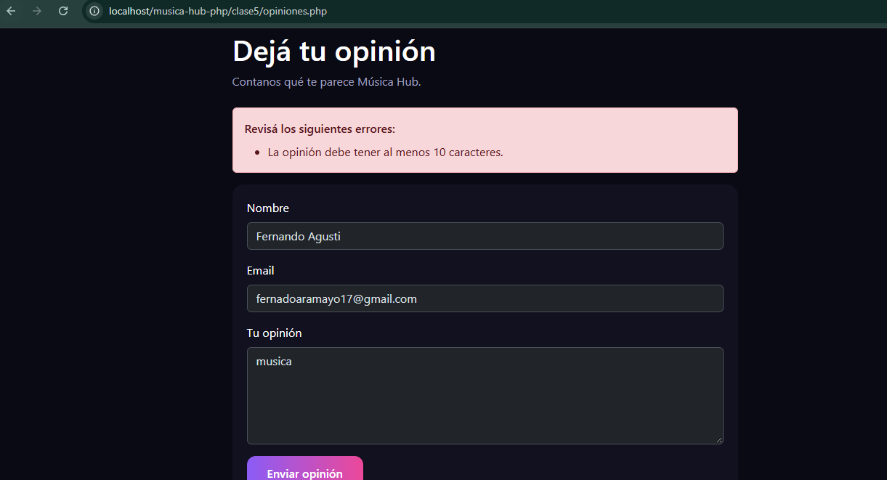

*Opiniones enviada con éxito*
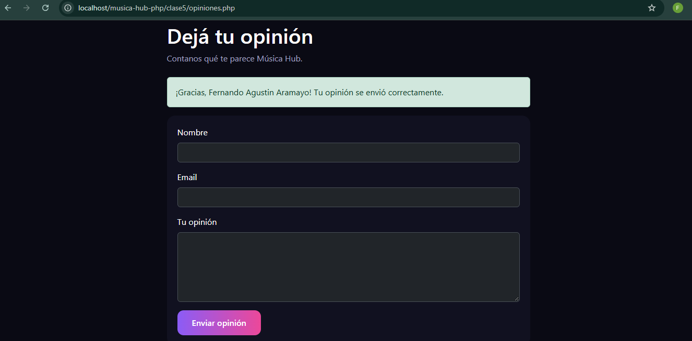

*Prueba de seguridad XSS* (el script se muestra como texto y no se ejecuta)
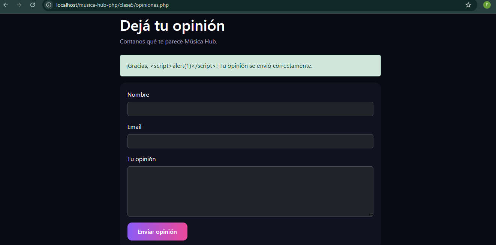

*Búsqueda con resultados* (método GET)
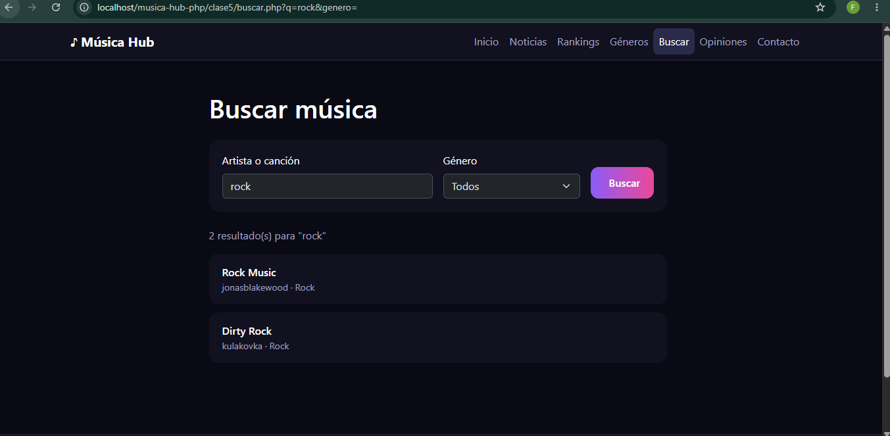

*Búsqueda con error de validación*
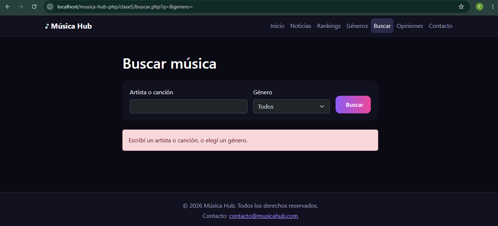

## TP 6: Diseño y creación del esquema relacional en MySQL

Todo el desarrollo está en la carpeta tp6/.

- tp6/NORMALIZACION.md: tabla sin normalizar, 1FN, 2FN, 3FN y lista de tablas con sus PK y FK.
- tp6/schema.sql: crea la base musica_hub con 7 tablas, claves primarias y foráneas, campos de auditoría e índices.
- tp6/consultas.sql: inserciones, consultas con WHERE, ORDER BY e INNER JOIN, un UPDATE y un DELETE.

### Capturas de pantalla

*Tablas creadas en phpMyAdmin*
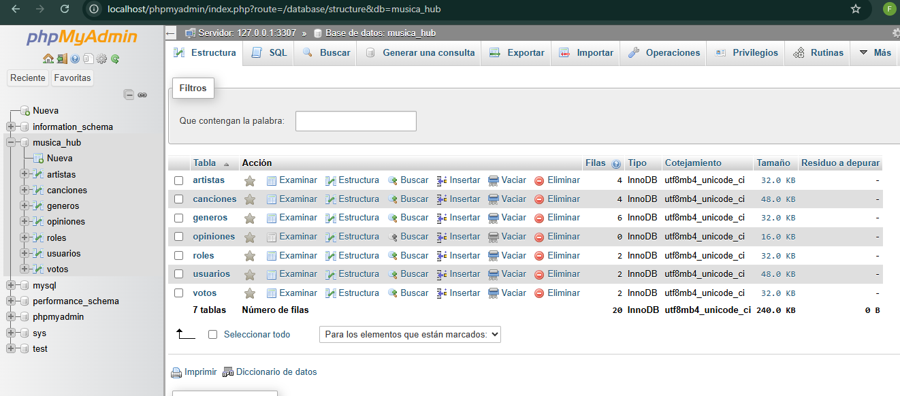

*Consulta con INNER JOIN*
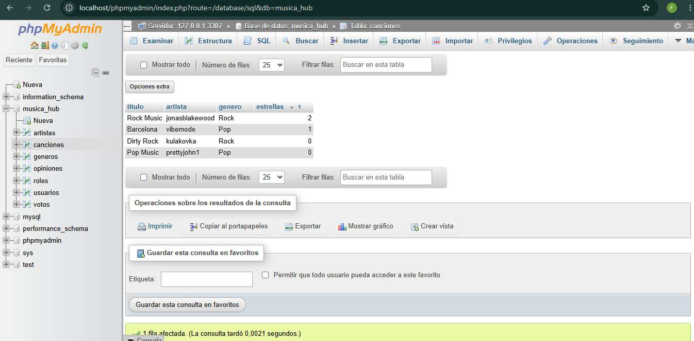

## TP 7: Persistencia y conexión PHP-MySQL segura

Módulo CRUD de canciones integrado al sitio, en la carpeta admin/. Usa la base musica_hub del TP 6.

- config/conexion.php: conexión PDO con try-catch. Los datos de conexión se leen del archivo .env.
- admin/index.php: listado de canciones (Read) con INNER JOIN a artistas y géneros.
- admin/crear.php: alta de canciones (Create).
- admin/editar.php: modificación de canciones (Update).
- admin/eliminar.php: baja de canciones (Delete).

### Seguridad
- Todas las consultas usan *sentencias preparadas* con parámetros nombrados (:titulo, :id, etc.) para evitar inyección SQL.
- Toda variable impresa en pantalla pasa por htmlspecialchars() (función h()) para evitar XSS.
- Validación en el servidor: campos obligatorios y filter_var para los identificadores.

### Capturas de pantalla

*Listado de canciones (Read)*
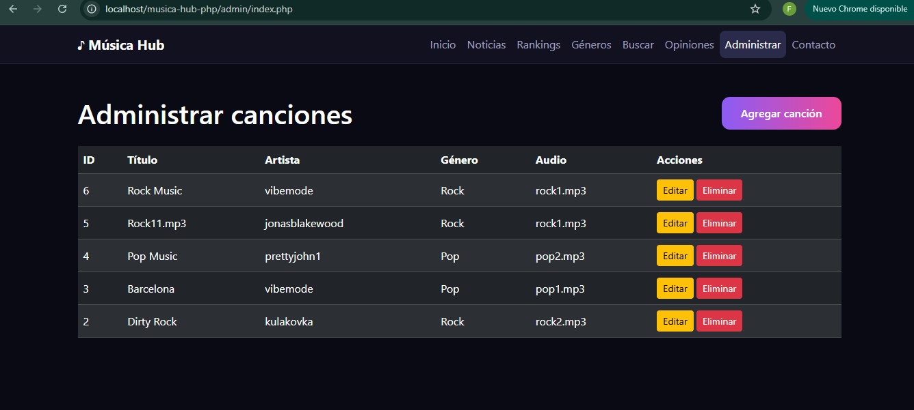

*Formulario de alta con errores de validación (Create)*

*Formulario de edición (Update)*
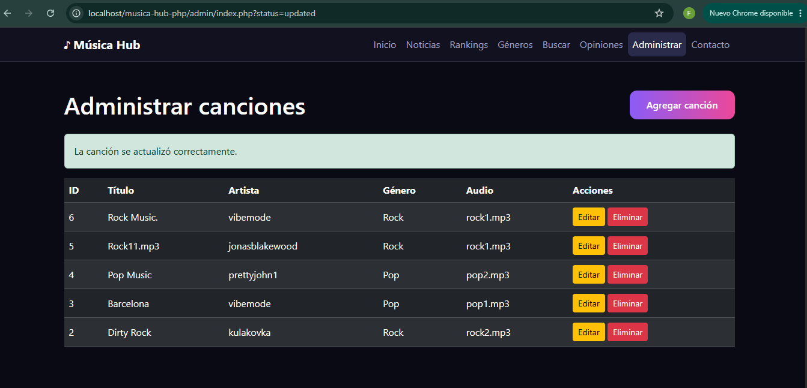

*Eliminación de un registro (Delete)*
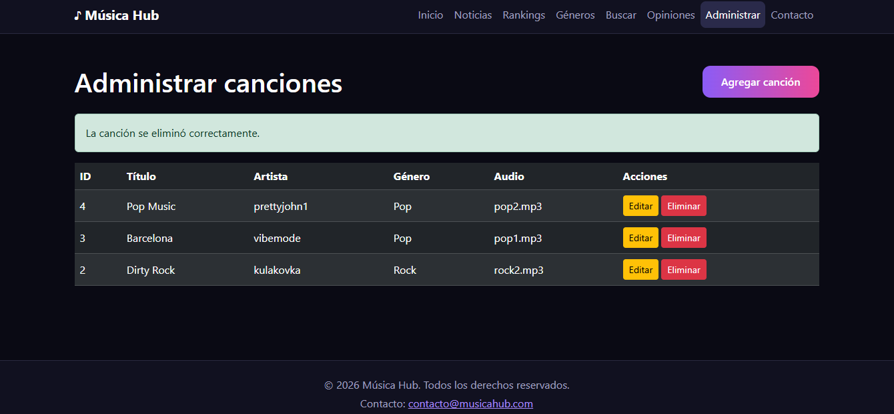

*Datos reflejados en MySQL (phpMyAdmin)*
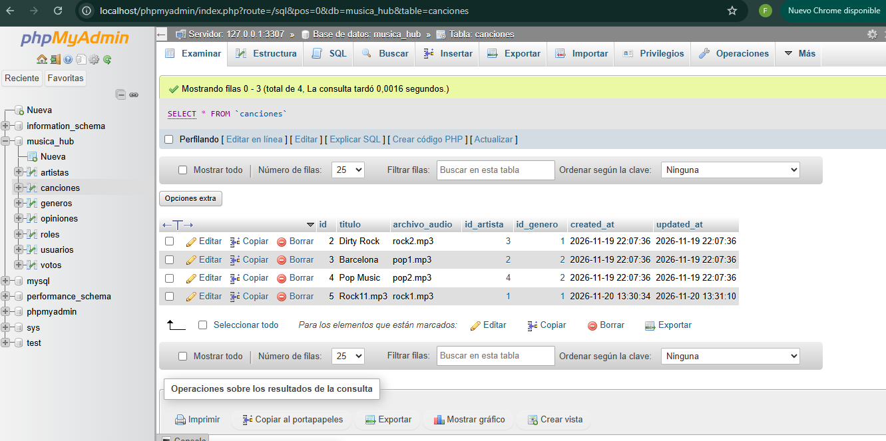

## TP 8: Manejo de estado, sesiones y autenticación

Módulo de registro, inicio y cierre de sesión integrado al sitio.

- registro.php: alta de usuarios con validación, verificación de email único y contraseña con password_hash(..., PASSWORD_BCRYPT).
- login.php: valida credenciales con password_verify(), ejecuta session_regenerate_id(true) y guarda usuario_id, usuario_nombre y rol en $_SESSION.
- includes/auth_guard.php: guardián de rutas. Si no hay sesión, redirige a login.php?error=acceso_denegado. Incluye control por rol.
- panel.php: página protegida para cualquier usuario autenticado.
- admin_panel.php: página protegida solo para el rol admin.
- admin/: el CRUD de canciones también exige sesión iniciada.
- logout.php: vacía $_SESSION, elimina la cookie de sesión y ejecuta session_destroy().

### Seguridad
- Contraseñas guardadas como hash bcrypt, nunca en texto plano.
- Consultas preparadas con PDO en todas las operaciones.
- htmlspecialchars() en todo dato impreso.
- Regeneración del identificador de sesión al iniciar sesión (previene fijación de sesión).

### Capturas de pantalla

*Registro con error de validación*
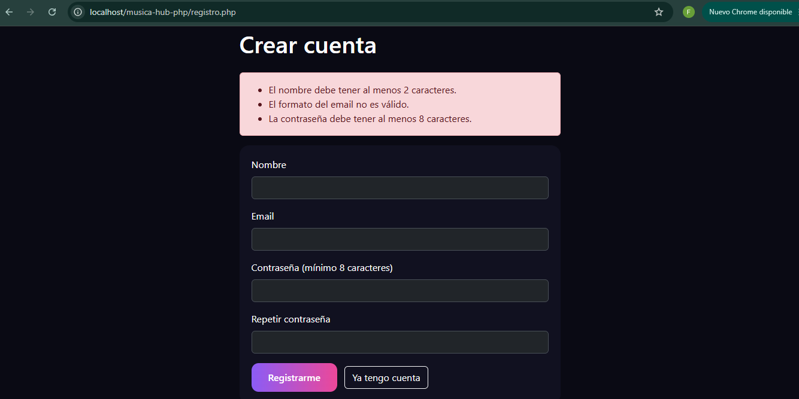

*Login con credenciales incorrectas*
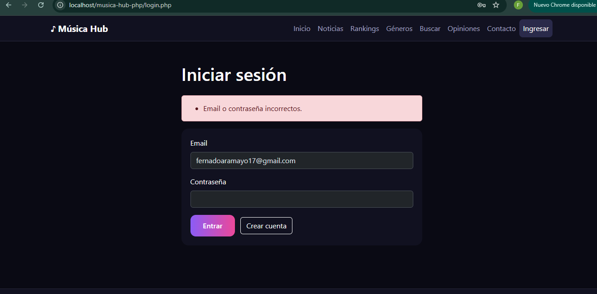

*Acceso denegado sin sesión*
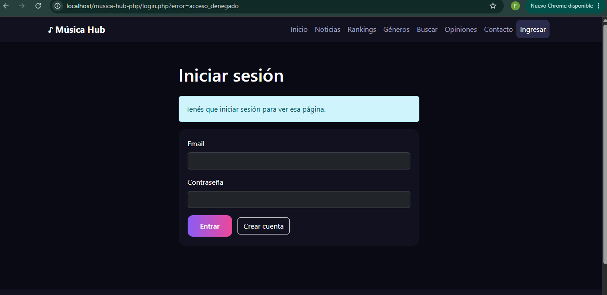

*Panel del usuario autenticado*

*Panel de administración (rol admin)*
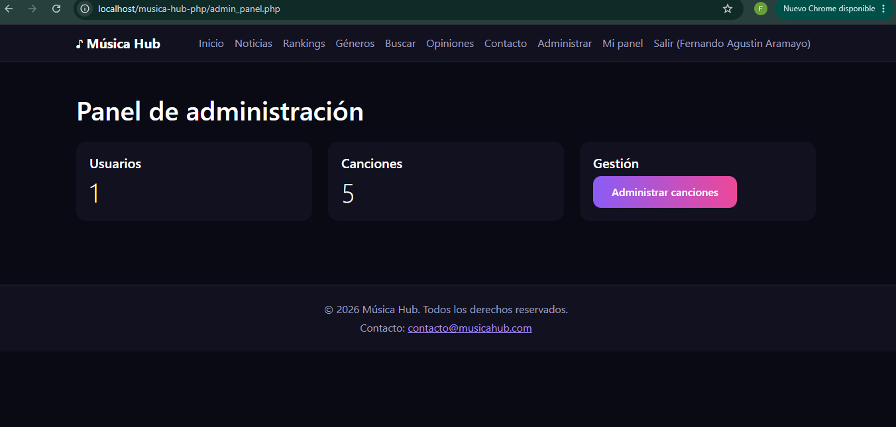

*Usuario común sin permisos para el panel de administración*
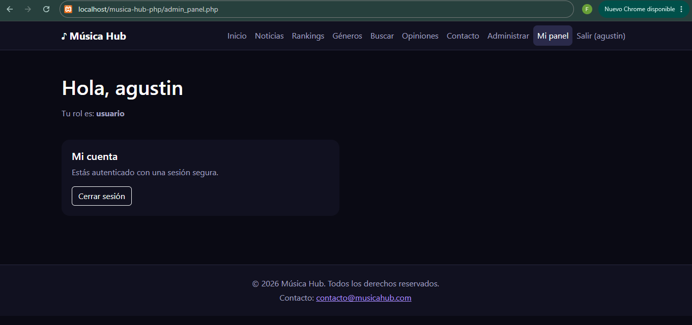

*Contraseña guardada como hash en la base de datos*
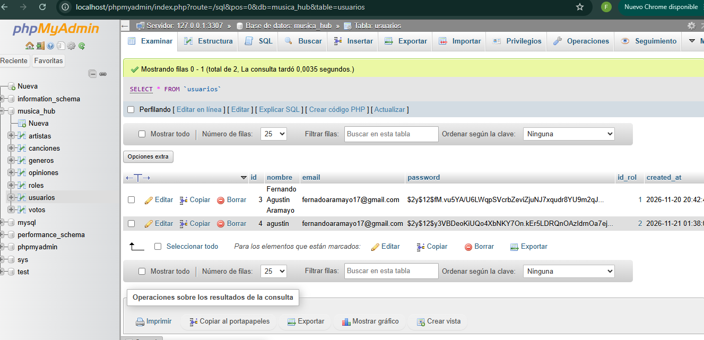