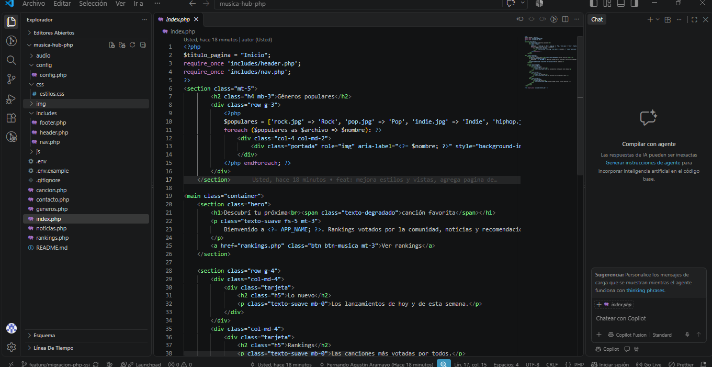

# Música Hub

Sitio web de música donde la comunidad descubre canciones, vota con estrellas y consulta rankings, géneros, noticias y giras. En esta etapa (Unidad 4) la maqueta estática se migró a *PHP, se modularizó con **Server Side Includes (SSI)* y se agregaron títulos dinámicos y variables de entorno (.env).

## Prototipo en Figma
https://twice-satin-42519228.figma.site/

## Tecnologías utilizadas
- HTML5, CSS3 y Bootstrap 5
- JavaScript
- PHP 8.x
- XAMPP (Apache) como servidor local
- Git y GitHub

## Estructura del proyecto
- includes/header.php: etiquetas <head>, metadatos, hojas de estilo y título dinámico.
- includes/nav.php: menú de navegación con la clase active en la sección actual.
- includes/footer.php: pie de página y scripts de JavaScript.
- config/config.php: lee el archivo .env y define las constantes del sitio.
- .env.example: plantilla de las variables de entorno.

## Instalación y ejecución local
1. Instalar XAMPP e iniciar *Apache* desde el panel de control.
2. Clonar el repositorio dentro de C:\xampp\htdocs:
   git clone https://github.com/Fer-123778/musica-hub-php.git
3. Copiar .env.example y renombrar la copia como .env.
4. Abrir en el navegador: http://localhost/musica-hub-php/

## Evidencia de funcionamiento

### Servidor local ejecutándose

### Estructura modular (SSI)

### Navegación dinámica (título y menú activo)

### Variables de entorno

